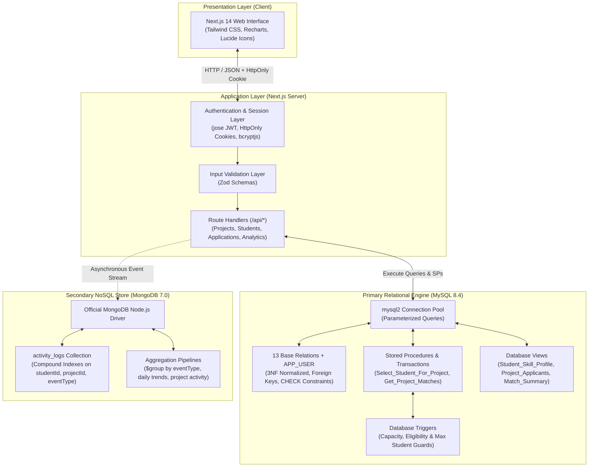
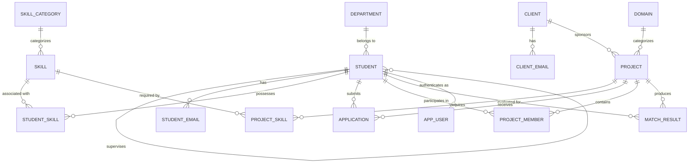

# Student Skill–Project Matching

A full-stack, enterprise-grade project allocation platform built with **Next.js 14**, **TypeScript**, **MySQL 8.4**, and **MongoDB 7.0**. The system matches student technical capabilities with organizational project requirements, enforcing database-level integrity, role-based workflows, and atomic transaction execution.

---

## Table of Contents

1. [Project Overview](#project-overview)
2. [System Architecture](#system-architecture)
3. [Key Features by Role](#key-features-by-role)
4. [Technology Stack](#technology-stack)
5. [Database Architecture & Design](#database-architecture--design)
   - [Relational Schema (MySQL)](#relational-schema-mysql)
   - [Entity-Relationship Diagram](#entity-relationship-diagram)
   - [NoSQL Event Store (MongoDB)](#nosql-event-store-mongodb)
6. [Advanced Database Implementation](#advanced-database-implementation)
   - [Database Views](#database-views)
   - [Stored Procedures](#stored-procedures)
   - [Triggers](#triggers)
   - [ACID Transactions & Row Locking](#acid-transactions--row-locking)
   - [MongoDB Aggregation Pipelines](#mongodb-aggregation-pipelines)
7. [Matching Logic & Algorithmic Results](#matching-logic--algorithmic-results)
8. [Installation & Local Setup](#installation--local-setup)
9. [Environment Configuration](#environment-configuration)
10. [Local Demo Accounts](#local-demo-accounts)
11. [Testing & Verification Evidence](#testing--verification-evidence)
12. [SQL Demonstration Guide](#sql-demonstration-guide)
13. [API Route Reference](#api-route-reference)
14. [Security & Architectural Notes](#security--architectural-notes)
15. [Project Directory Structure](#project-directory-structure)
16. [Future Roadmap](#future-roadmap)

---

## Project Overview

In academic institutions and organizational research environments, allocating collaborative projects to candidates manually introduces capacity bottlenecks, inconsistent skill verification, and uncoordinated application tracking.

**Student Skill–Project Matching** resolves these challenges by providing:
- **Verified Candidate Portfolios:** Candidates record academic profiles and verified skill competencies with standardized proficiency levels and years of experience.
- **Capacity-Enforced Project Management:** Administrators manage project lifecycle states, capacity limits, and domain/client mappings with real-time slot tracking.
- **Database-Enforced Business Rules:** Database triggers prevent invalid applications or capacity oversubscription before records are written.
- **Concurrency-Safe Selection:** Candidate selection is executed via a database stored procedure with exclusive row locking (`SELECT FOR UPDATE`), guaranteeing strict atomicity and zero race conditions.
- **Polyglot Audit Logging:** Core entities reside in MySQL with ACID guarantees, while temporal lifecycle events stream to MongoDB for historical audit tracking and analytical aggregations.

---

## System Architecture

The platform adopts a **polyglot persistence architecture** separating transactional relational records from temporal audit logs:



### Architectural Separation of Concerns
1. **MySQL as Primary Source of Truth:** Manages all transactional business entities (`STUDENT`, `PROJECT`, `APPLICATION`, `PROJECT_MEMBER`, `MATCH_RESULT`). Transaction atomicity, relational integrity, row locks, and eligibility checks remain strictly within MySQL InnoDB.
2. **MongoDB as Secondary Event Store:** Receives non-blocking event logs (`APPLICATION_SUBMITTED`, `APPLICATION_SELECTED`, `SKILL_UPDATED`, `PROJECT_CREATED`) for analytics and audit trails. The system does not rely on distributed two-phase commits; MongoDB logging failures do not abort relational transactions.

---

## Key Features by Role

### Student Portal
- **Authentication & Dashboard:** Secure sign-in with role-based redirection, displaying academic standing, total recorded skills, active applications, and memberships.
- **Academic Profile:** View department affiliation, academic year, CGPA, assigned supervisor, and registered contact emails.
- **Skills Management (CRUD):** Add, update, and delete technical skills with standardized proficiency levels (`Beginner`, `Intermediate`, `Advanced`, `Expert`) and years of experience, backed by the `Student_Skill_Profile` view.
- **Project Catalog & Real-Time Capacity:** Browse open projects with domain metadata, client organizations, required skills, and remaining capacity slots.
- **Application Submission:** Submit applications to open projects with immediate database trigger verification.
- **Stored Match Results:** Inspect evaluated match scores, matched skill highlights, and missing skill requirements retrieved from `Project_Match_Summary`.
- **Application Lifecycle Tracking:** Monitor application statuses (`Applied`, `Shortlisted`, `Selected`, `Rejected`) and withdraw pending applications.
- **Project Memberships:** View assigned project development roles, joined dates, and active participation status.
- **Personal Activity History:** Review an audit timeline of personal actions retrieved from MongoDB.

### Administrator Console
- **Operational Overview:** Real-time KPI cards (enrolled students, total projects, active projects, submitted applications, active members, and MongoDB audit count).
- **Student Directory:** Search candidates by name or student ID, filter by department and academic year, and view student skill profiles via database views.
- **Project Lifecycle Management:** Create, update, and delete projects with start/end dates, client assignments, domain categorization, and capacity limits.
- **Application Review:** Inspect submitted applications by project and status, with actions to Shortlist, Reject, or commit final Selection.
- **Ranked Candidate Matching:** Execute `CALL Get_Project_Matches(?)` to retrieve candidate rankings ordered descending by evaluated match score.
- **Atomic Student Selection:** Execute `CALL Select_Student_For_Project(?, ?, ?)` with database row locking (`SELECT FOR UPDATE`), promoting applications to `Selected` and inserting active project members atomically.
- **Capacity Monitoring:** Visual progress bars and slot counters enforcing project capacity limits.
- **Analytics & Aggregations:** Interactive Recharts visualizations powered by SQL relational queries (`GROUP BY`, `HAVING`, `AVG`, `MAX`, subqueries) and MongoDB aggregation pipelines.

---

## Technology Stack

| Layer / Component | Technology | Version | Purpose |
|---|---|---|---|
| **Framework** | Next.js (App Router) | `14.2.18` | Server-side rendering, dynamic API route handlers, and page routing |
| **User Interface** | React | `18.3.1` | Component-driven frontend interface |
| **Language** | TypeScript | `5.6.3` | End-to-end static typing and interface enforcement |
| **Styling** | Tailwind CSS | `3.4.15` | Responsive, minimal styling with slate/navy palette |
| **Relational Database** | MySQL (InnoDB) | `8.4.x` | Primary ACID relational database, views, procedures, and triggers |
| **NoSQL Database** | MongoDB Community | `7.0.x` | High-throughput activity event stream and analytical aggregation |
| **SQL Client** | `mysql2/promise` | `3.11.4` | Connection pool, parameterized queries, and transaction management |
| **NoSQL Client** | `mongodb` | `6.10.0` | Official Node.js driver for MongoDB |
| **Authentication** | `jose` | `5.9.6` | Lightweight, edge-compatible HS256 JWT session tokens |
| **Password Hashing** | `bcryptjs` | `2.4.3` | Salted password hashing (10 salt rounds) |
| **Schema Validation** | `zod` | `3.23.8` | Strict runtime request and DTO schema validation |
| **Data Visualization** | `recharts` | `2.13.3` | Declarative SVG bar charts and trend visualizations |
| **Icons** | `lucide-react` | `0.460.0` | Lightweight SVG icons |

---

## Database Architecture & Design

### Relational Schema (MySQL)

The relational engine organizes data across 14 normalized tables:
- **`DEPARTMENT`**: Academic departments (`dept_id`, `dept_name`).
- **`STUDENT`**: Student profiles (`student_id`, `name`, `year`, `cgpa`, `dept_id`, `supervisor_id`).
- **`STUDENT_EMAIL`**: Multi-valued contact emails (`student_id`, `email`).
- **`SKILL_CATEGORY`**: Categorization (`category_id`, `category_name`).
- **`SKILL`**: Master skills catalog (`skill_id`, `skill_name`, `category_id`).
- **`STUDENT_SKILL`**: Associative skill profiles (`student_id`, `skill_id`, `proficiency_level`, `years_experience`).
- **`CLIENT`**: Sponsoring organizations (`client_id`, `org_name`, `contact_name`, `industry`).
- **`CLIENT_EMAIL`**: Contact emails for clients (`client_id`, `email`).
- **`DOMAIN`**: Technical domains (`domain_id`, `domain_name`).
- **`PROJECT`**: Project definitions (`project_id`, `title`, `description`, `start_date`, `end_date`, `max_students`, `status`, `client_id`, `domain_id`).
- **`PROJECT_SKILL`**: Required skills for projects (`project_id`, `skill_id`, `required_level`, `importance`).
- **`APPLICATION`**: Candidate submissions (`student_id`, `project_id`, `application_date`, `status`).
- **`PROJECT_MEMBER`**: Active memberships (`student_id`, `project_id`, `role`, `joined_date`, `member_status`).
- **`MATCH_RESULT`**: Evaluated match scores (`student_id`, `result_no`, `project_id`, `match_score`, `matched_skills`, `missing_skills`, `status`).
- **`APP_USER`**: Authentication credentials (`user_id`, `email`, `password_hash`, `role`, `student_id`, `created_at`).

### Entity-Relationship Diagram



### NoSQL Event Store (MongoDB)

Collection: `activity_logs`
```json
{
  "_id": "67295fa0...",
  "eventType": "APPLICATION_SUBMITTED",
  "studentId": 105,
  "projectId": 504,
  "userId": 6,
  "timestamp": "2026-11-05T15:32:00.123Z",
  "metadata": {
    "applicationDate": "2026-11-05"
  }
}
```

Compound indexes ensure query efficiency:
- `{ studentId: 1, timestamp: -1 }` (Personal student audit history)
- `{ projectId: 1, timestamp: -1 }` (Project-specific activity)
- `{ eventType: 1 }` (Event category analytics)
- `{ timestamp: -1 }` (Timeline sorting)

---

## Advanced Database Implementation

### Database Views

1. **`Student_Skill_Profile`**:
   - Performs multi-table `LEFT JOIN` across `STUDENT`, `DEPARTMENT`, `STUDENT_SKILL`, `SKILL`, and `SKILL_CATEGORY`.
   - Ensures students without recorded skills still appear (skill columns are `NULL`).
2. **`Project_Applicants`**:
   - Joins `APPLICATION`, `STUDENT`, and `PROJECT` to expose candidate name, CGPA, application date, and project title.
3. **`Project_Match_Summary`**:
   - Joins `MATCH_RESULT`, `STUDENT`, and `PROJECT` to retrieve match scores, matched skills, and missing skills.

### Stored Procedures

1. **`Get_Project_Matches(IN p_project_id INT)`**:
   - Retrieves candidates for a project ordered by `match_score DESC, student_id ASC, result_no ASC`.
2. **`Assert_Project_Has_Room(IN p_project_id, IN p_context, IN p_check_open, IN p_check_capacity)`**:
   - Shared business rule validator called by triggers.
   - Acquires a row-level lock (`SELECT ... FOR UPDATE`) on the project row.
   - Verifies project existence, verifies status is `'Open'`, and ensures active members in `PROJECT_MEMBER` do not exceed `max_students`.
3. **`Select_Student_For_Project(IN p_student_id, IN p_project_id, IN p_role)`**:
   - Implements atomic candidate selection with row locking.

### Triggers

1. **`Check_Application_Eligibility` (`BEFORE INSERT ON APPLICATION`)**:
   - Calls `Assert_Project_Has_Room(NEW.project_id, 'Application', 1, 1)`.
   - Rejects applications if the target project does not exist, is not Open, or is full.
2. **`Check_Project_Capacity` (`BEFORE INSERT ON PROJECT_MEMBER`)**:
   - Verifies that adding an `'Active'` member does not exceed `max_students`.
3. **`Check_Member_Update_Capacity` (`BEFORE UPDATE ON PROJECT_MEMBER`)**:
   - Enforces capacity checks when an inactive member is reactivated or reassigned.
4. **`Check_Project_Max_Students_Update` (`BEFORE UPDATE ON PROJECT`)**:
   - Prevents administrators from reducing `max_students` below the current count of active members.

### ACID Transactions & Row Locking

The student selection workflow inside `Select_Student_For_Project` demonstrates strict ACID transaction isolation:
```sql
START TRANSACTION;

-- 1. Exclusive row-level lock on the project
SELECT project_id INTO v_locked_project
FROM PROJECT
WHERE project_id = p_project_id
FOR UPDATE;

-- 2. Update application status
UPDATE APPLICATION
SET status = 'Selected'
WHERE student_id = p_student_id
  AND project_id = p_project_id
  AND status IN ('Applied', 'Shortlisted');

-- 3. Insert membership record (fires Check_Project_Capacity trigger)
INSERT INTO PROJECT_MEMBER (student_id, project_id, role, joined_date, member_status)
VALUES (p_student_id, p_project_id, p_role, CURDATE(), 'Active');

COMMIT;
```
If any error occurs (e.g. capacity trigger rejection or candidate not shortlisted), the `DECLARE EXIT HANDLER FOR SQLEXCEPTION` executes `ROLLBACK; RESIGNAL;`, ensuring no partial changes persist.

### MongoDB Aggregation Pipelines

1. **Event Breakdown by Type:**
   ```javascript
   db.activity_logs.aggregate([
     { $group: { _id: "$eventType", count: { $sum: 1 }, lastOccurred: { $max: "$timestamp" } } },
     { $sort: { count: -1 } }
   ]);
   ```
2. **Project Activity Breakdown:**
   ```javascript
   db.activity_logs.aggregate([
     { $match: { projectId: { $ne: null } } },
     { $group: { _id: "$projectId", totalEvents: { $sum: 1 }, events: { $push: { eventType: "$eventType", studentId: "$studentId", timestamp: "$timestamp" } } } },
     { $sort: { totalEvents: -1 } },
     { $limit: 10 }
   ]);
   ```
3. **Daily Activity Timeline:**
   ```javascript
   db.activity_logs.aggregate([
     { $match: { timestamp: { $gte: cutoffIsoString } } },
     { $project: { dateStr: { $substr: ["$timestamp", 0, 10] } } },
     { $group: { _id: "$dateStr", count: { $sum: 1 } } },
     { $sort: { _id: 1 } }
   ]);
   ```

---

## Matching Logic & Algorithmic Results

The application represents matching assessments through stored records in the `MATCH_RESULT` table:
- **Precomputed Assessment:** Evaluated candidate match percentages (`match_score`), matched skills lists, and missing skill requirements are stored with relational constraints (`0 <= match_score <= 100`).
- **Ranked Candidate Retrieval:** The application executes `CALL Get_Project_Matches(?)` to sort candidate match summaries in descending order.
- **Data Grounding:** The interface displays the stored algorithmic scores from `MATCH_RESULT` without fabricating artificial or ungrounded client-side match percentages.

---

## Installation & Local Setup

### Prerequisites
- **Node.js:** v20.6.0+ (Tested on v26.4.0)
- **npm:** v10.0.0+ (Tested on v11.17.0)
- **MySQL Server:** v8.0.16+ (Tested on v8.4.x via Homebrew)
- **MongoDB Community Server:** v7.0.x (Tested on v7.0.37 via Homebrew)

### Setup Steps

1. **Clone the repository:**
   ```bash
   git clone https://github.com/2306apk/Student-Skill-Based-Project-Matching.git
   cd Student-Skill-Based-Project-Matching
   ```

2. **Install dependencies:**
   ```bash
   npm install
   ```

3. **Configure environment variables:**
   ```bash
   cp .env.example .env
   ```
   Edit `.env` with your local database credentials (see [Environment Configuration](#environment-configuration)).

4. **Initialize MySQL schema & sample dataset:**
   ```bash
   mysql -u root -p < "student_skill_project_matching (4).sql"
   ```

5. **Run the additive authentication migration:**
   ```bash
   npm run db:migrate
   ```

6. **Seed local demonstration accounts:**
   ```bash
   npm run db:seed
   ```

7. **Verify database connectivity:**
   ```bash
   npm run test:db
   ```

8. **Start the development server:**
   ```bash
   npm run dev
   ```
   Open [http://localhost:3000](http://localhost:3000) in your browser.

---

## Environment Configuration

Create a `.env` file in the project root:

| Variable | Type | Default | Description |
|---|---|---|---|
| `MYSQL_HOST` | String | `127.0.0.1` | Hostname of the MySQL database instance |
| `MYSQL_PORT` | Number | `3306` | Port number of the MySQL server |
| `MYSQL_USER` | String | `root` | MySQL user account |
| `MYSQL_PASSWORD` | String | `""` | MySQL user password |
| `MYSQL_DATABASE` | String | `student_skill_project_matching` | Database name |
| `MONGODB_URI` | String | `mongodb://127.0.0.1:27017/...` | MongoDB connection URI |
| `MONGODB_DB` | String | `student_skill_project_matching` | Target MongoDB database name |
| `JWT_SECRET` | String | (32+ chars) | Cryptographic secret for signing session JWTs |
| `NEXT_PUBLIC_APP_URL`| String | `http://localhost:3000` | Application base URL |

---

## Local Demo Accounts

> **Note:** The credentials below are provided strictly for local demonstration and evaluation. Change all secrets in production environments.

| Role | Email | Password | Student ID | Associated Name |
|---|---|---|---|---|
| **Administrator** | `admin@college.edu` | `Admin@123` | *None* | System Administrator |
| **Student** | `rahul@gmail.com` | `Student@123` | `101` | Rahul |
| **Student** | `ananya@gmail.com` | `Student@123` | `102` | Ananya |
| **Student** | `vikram@gmail.com` | `Student@123` | `103` | Vikram |
| **Student** | `sneha@gmail.com` | `Student@123` | `104` | Sneha |
| **Student** | `arjun@gmail.com` | `Student@123` | `105` | Arjun |

---

## Testing & Verification Evidence

Run test suites using the following commands:

```bash
# 1. Dual-Database Connectivity Verification
npm run test:db

# 2. Business Rules & Constraint Unit Tests
npx tsx tests/business-rules.test.ts

# 3. Systematic End-to-End Functional Test Suite
npx tsx tests/e2e-functional.test.ts

# 4. TypeScript Strict Compilation
npx tsc --noEmit

# 5. ESLint Code Quality Check
npx next lint

# 6. Production Build Verification
npm run build
```

### Verified Test Results Summary
- **End-to-End Functional Tests ([`tests/e2e-functional.test.ts`](file:///Users/apoorva_kogta/Documents/DBMS_Proj/tests/e2e-functional.test.ts)):** **30 / 30 Passed**
  - Authentication (Admin & Student roles), session token verification.
  - Security & authorization (unauthenticated 401, student access to admin API 403, URL tampering 403).
  - Admin overview, student management, project CRUD, application review.
  - Stored procedure execution (`CALL Get_Project_Matches`).
  - Student profile retrieval, skills CRUD (`INSERT`, `SELECT`, `UPDATE`, `DELETE`).
  - Trigger rejection (`Check_Application_Eligibility` returning SQLSTATE 45000).
  - Atomic transaction selection (`CALL Select_Student_For_Project`) with row locking and rollback verification.
  - MongoDB activity history logging and aggregation retrieval.
- **Business Rule Unit Tests ([`tests/business-rules.test.ts`](file:///Users/apoorva_kogta/Documents/DBMS_Proj/tests/business-rules.test.ts)):** **16 / 16 Passed**
- **SQL Demonstration Script ([`phase3_sql_demonstrations.sql`](file:///Users/apoorva_kogta/Documents/DBMS_Proj/phase3_sql_demonstrations.sql)):** **10 / 10 Sections Executed with 0 Errors**
- **TypeScript Static Typecheck:** **0 Errors**
- **Next.js Production Build:** **Compiled all 36 dynamic routes and static pages cleanly**

---

## SQL Demonstration Guide

The repository includes [`phase3_sql_demonstrations.sql`](file:///Users/apoorva_kogta/Documents/DBMS_Proj/phase3_sql_demonstrations.sql) to demonstrate SQL concepts against the live database:

```bash
mysql -u root -p < phase3_sql_demonstrations.sql
```

### Demonstration Script Sections
1. **DDL Statements:** `CREATE TABLE`, `ALTER TABLE`, and disposable `DROP TABLE` on `TEMP_AUDIT_EXPERIMENT`.
2. **DML CRUD:** Safe, repeatable `INSERT`, `SELECT`, `UPDATE`, and `DELETE` on `STUDENT_SKILL` using test student `105`.
3. **Relational Clauses:** Multi-table `JOIN`, `GROUP BY`, `HAVING COUNT(*) > 1`, and `ORDER BY match_score DESC`.
4. **Aggregate Functions:** `COUNT()`, `ROUND(AVG(), 2)`, `MAX()`, and `MIN()` on `MATCH_RESULT`.
5. **Advanced Subqueries:**
   - Scalar: `WHERE match_score > (SELECT AVG(match_score) FROM MATCH_RESULT)`
   - `IN` / `NOT IN`: Students who applied but have no active membership.
   - Correlated: Calculating active members and remaining project capacity dynamically.
6. **Database Views:** Querying `Student_Skill_Profile`, `Project_Applicants`, and `Project_Match_Summary`.
7. **Stored Procedures:** Calling `CALL Get_Project_Matches(501)`.
8. **Triggers:** Verifying rejection on invalid projects (`Check_Application_Eligibility`) and capacity reductions (`Check_Project_Max_Students_Update`).
9. **ACID Transactions:** Demonstrating `START TRANSACTION`, `SELECT FOR UPDATE`, row locking, and `ROLLBACK`.
10. **Indexes:** Inspecting secondary composite indexes across tables.

---

## API Route Reference

| Method | Endpoint | Access | Description |
|---|---|---|---|
| `POST` | `/api/auth/login` | Public | Authenticates credentials; sets HttpOnly JWT session cookie; logs event |
| `POST` | `/api/auth/logout` | Authenticated | Clears session cookie |
| `GET` | `/api/auth/me` | Authenticated | Retrieves current authenticated session and profile data |
| `GET` | `/api/students` | Admin | Lists students with search by name/ID, department, and academic year filters |
| `GET` | `/api/students/me` | Student | Retrieves personal academic profile and registered emails |
| `GET` | `/api/students/me/skills` | Student | Lists student's skills via `Student_Skill_Profile` view |
| `POST` | `/api/students/me/skills` | Student | Adds skill to `STUDENT_SKILL`; logs `SKILL_ADDED` in MongoDB |
| `PATCH` | `/api/students/me/skills/[id]` | Student | Updates proficiency/experience; enforces CHECK constraint |
| `DELETE`| `/api/students/me/skills/[id]` | Student | Deletes skill association; logs `SKILL_REMOVED` in MongoDB |
| `GET` | `/api/students/[id]/skills` | Admin | Views skill profile for any student via `Student_Skill_Profile` |
| `GET` | `/api/projects` | Authenticated | Lists projects with live active member counts and remaining slots |
| `POST` | `/api/projects` | Admin | Creates project and required skills in relational transaction |
| `GET` | `/api/projects/[id]` | Authenticated | Retrieves project details, required skills, and active members |
| `PATCH` | `/api/projects/[id]` | Admin | Updates project; triggers `Check_Project_Max_Students_Update` on capacity reduction |
| `DELETE`| `/api/projects/[id]` | Admin | Deletes project with referential integrity verification |
| `GET` | `/api/applications` | Authenticated | Lists applications via `Project_Applicants` view (scoped to student if not Admin) |
| `POST` | `/api/applications` | Student | Submits application; evaluated by `Check_Application_Eligibility` trigger |
| `PATCH` | `/api/applications/[id]` | Authenticated | Shortlists, Rejects (Admin) or Withdraws (Student) an application |
| `GET` | `/api/matches/project/[id]` | Admin | Executes `CALL Get_Project_Matches(?)` for ranked candidate matches |
| `GET` | `/api/matches/me` | Student | Retrieves evaluated match results from `Project_Match_Summary` view |
| `GET` | `/api/memberships` | Authenticated | Lists active project members and assigned development roles |
| `POST` | `/api/memberships/select` | Admin | Executes `CALL Select_Student_For_Project(?, ?, ?)` with row locking |
| `GET` | `/api/metadata` | Public | Returns catalogs for skills, categories, departments, domains, and clients |
| `GET` | `/api/analytics/overview` | Authenticated | Returns system KPIs from MySQL aggregates and MongoDB document counts |
| `GET` | `/api/analytics/projects` | Admin | Executes relational queries (`GROUP BY`, `HAVING`, `AVG`, `MAX`, subqueries) |
| `GET` | `/api/analytics/activity` | Admin | Executes MongoDB aggregation pipelines for event breakdowns and daily trends |
| `GET` | `/api/activity/me` | Student | Retrieves personal event history from MongoDB `activity_logs` |

---

## Security & Architectural Notes

- **Password Storage:** Salted and hashed using `bcryptjs` with 10 salt rounds. Plaintext passwords are never stored.
- **Session Transport:** Signed HS256 tokens in `HttpOnly`, `SameSite=Lax` cookies, protected against XSS theft.
- **SQL Injection Prevention:** All relational queries use parameterized inputs (`?` placeholders) via `mysql2`.
- **Authorization & Parameter Tampering:** Server-side route handlers enforce role restrictions (`requireAuth(['ADMIN'])`) and verify student ID ownership (`verifyStudentAccess`).
- **Decoupled Audit Model:** MySQL maintains strict ACID consistency for business entities. MongoDB audit logging is non-blocking to prevent logging delays from interrupting relational transactions.
- **Development vs. Production:** Configuration is structured for local development environments. Production deployments require SSL termination, managed database instances with rotated credentials, and restricted CORS/Cookie domains.

---

## Project Directory Structure

```
.
├── app/
│   ├── admin/
│   │   ├── analytics/page.tsx      # Advanced SQL & MongoDB aggregation charts
│   │   ├── applications/page.tsx   # Application review, shortlisting & selection
│   │   ├── dashboard/page.tsx      # System overview KPIs & capacity progress bars
│   │   ├── layout.tsx              # Admin role protection & sidebar layout
│   │   ├── matches/page.tsx        # Ranked candidate retrieval (Get_Project_Matches SP)
│   │   ├── memberships/page.tsx    # Project member tracking & slot availability
│   │   ├── projects/page.tsx       # Project creation, editing & capacity management
│   │   └── students/page.tsx       # Student directory & Student_Skill_Profile modal
│   ├── api/                        # Next.js Server Route Handlers
│   ├── login/page.tsx              # Authentication portal with demo account quick-fill
│   ├── student/
│   │   ├── activity/page.tsx       # Student personal event stream from MongoDB
│   │   ├── applications/page.tsx   # Application status & withdrawal
│   │   ├── dashboard/page.tsx      # Student KPI overview & quick links
│   │   ├── layout.tsx              # Student role protection & sidebar layout
│   │   ├── matches/page.tsx        # Project_Match_Summary view results
│   │   ├── my-projects/page.tsx    # Active project assignments & roles
│   │   ├── profile/page.tsx        # Academic profile from STUDENT table
│   │   ├── projects/page.tsx       # Browse open projects with live capacity
│   │   └── skills/page.tsx         # Manage skills in STUDENT_SKILL (CRUD)
│   ├── globals.css                 # Base Tailwind styling
│   ├── layout.tsx                  # Root HTML wrapper
│   └── page.tsx                    # Role-based root redirector
├── components/
│   ├── layout/                     # Shared layout elements (Navbar, Sidebars)
│   └── ui/                         # Modals, status badges
├── lib/
│   ├── auth/                       # JWT issuance, verification & session helpers
│   ├── mongodb/client.ts           # MongoDB driver client & aggregation pipelines
│   ├── mysql/client.ts             # MySQL pool, query wrappers & trigger error formatting
│   └── validation/schemas.ts       # Zod validation schemas
├── migrations/
│   └── 001_create_app_user.sql     # Additive authentication schema migration
├── scripts/
│   ├── migrate.ts                  # Database migration executor
│   ├── seed.ts                     # Demo accounts seeding script
│   └── test-db.ts                  # Dual-database connectivity test
├── tests/
│   ├── business-rules.test.ts      # Automated unit tests for rules & JWT
│   └── e2e-functional.test.ts      # 30-step systematic end-to-end integration suite
├── phase3_sql_demonstrations.sql   # Standalone 10-section SQL demonstration script
├── student_skill_project_matching (4).sql # Base relational schema & sample dataset
├── .env.example                    # Environment template
├── next.config.mjs                 # Next.js configuration
├── package.json                    # Project dependencies and npm scripts
├── tailwind.config.ts              # Tailwind CSS design system configuration
└── tsconfig.json                   # TypeScript compiler settings
```

---

## Future Roadmap

- [ ] **Real-time WebSockets:** Live push notifications when application statuses change from `Applied` to `Shortlisted` or `Selected`.
- [ ] **Automated Skill Assessments:** Integrate coding sandbox evaluations directly into candidate profiles.
- [ ] **Multi-Department Project Allocation:** Support cross-department project collaborations with variable capacity quotas.
- [ ] **Document Export:** Generate PDF project allocation and candidate profile summaries.
